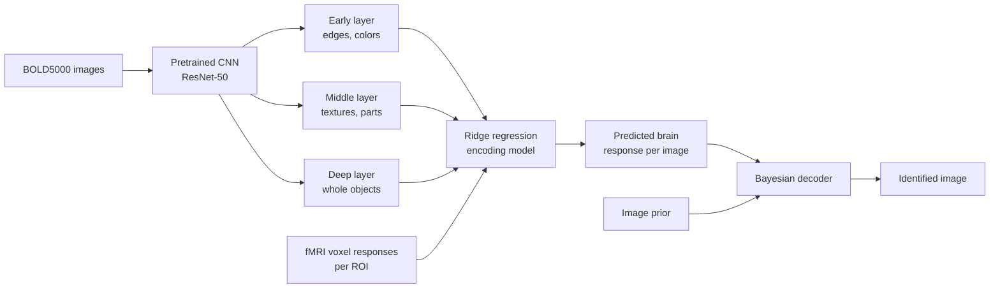
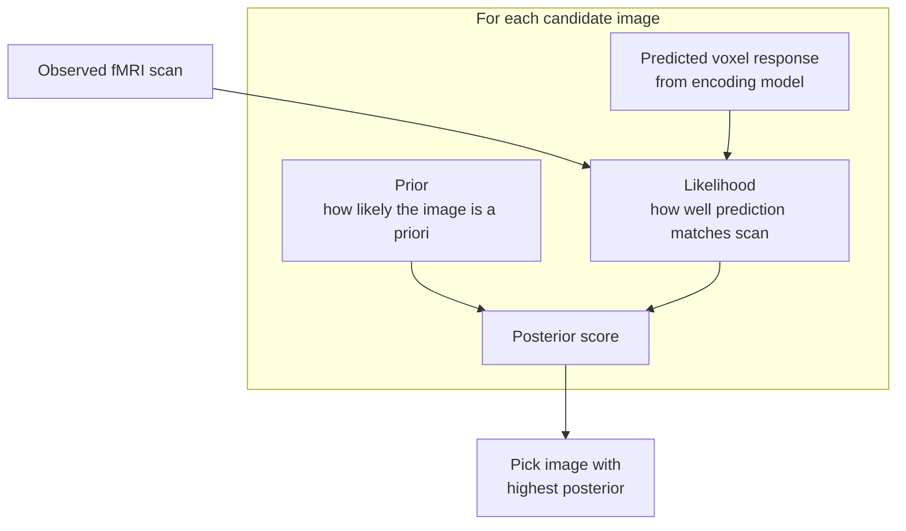
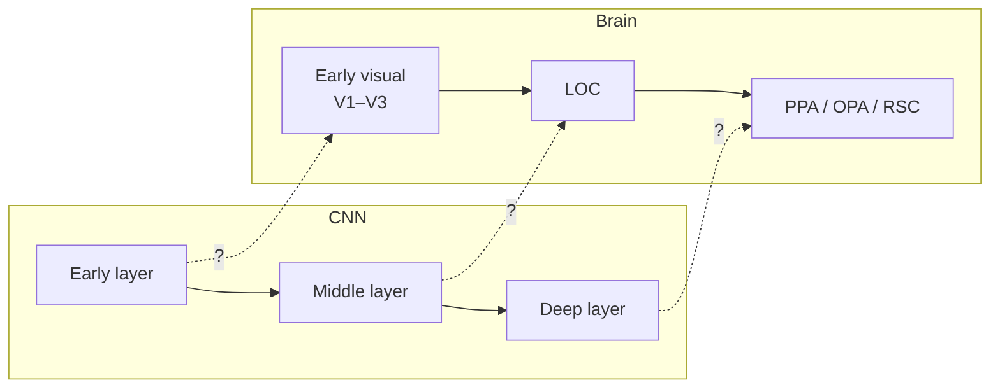

# Mind vs. Machine: fMRI Decoding with CNNs and Bayesian Inference
 
> Do artificial and biological vision systems process images in similar ways?
 
The human visual system processes what we see in a hierarchy: early regions respond to edges and colors, while later regions respond to whole objects and scenes. Convolutional neural networks (CNNs) were inspired by this design and learn a similar layered sequence. Drawing on Claude Shannon's information theory, many researchers argue this is no coincidence: any system that efficiently encodes natural images may converge on a similar solution.
 
This project puts that idea to the test. Using fMRI scans from people viewing ~5,000 natural images (BOLD5000), we build **encoding models** that predict voxel-level brain activity from CNN features, then flip them into a **Bayesian decoder** that identifies which image a person was viewing from their brain activity alone.
 
---
 
## Research Questions
 
| # | Question | Approach |
|---|----------|----------|
| **RQ1** | Do early, middle, and deep CNN layers strictly correspond to early, middle, and late visual processing regions in the human brain? | Compare encoding accuracy of each CNN layer across each visual ROI |
| **RQ2** | How much does adding an image prior help the Bayesian model pick the right image, compared to relying only on the predicted brain response? | Compare identification accuracy of likelihood-only vs. full posterior (likelihood × prior) decoding |
| **RQ3** | Which copula family (Gaussian, Clayton, or Gumbel) best captures the non-linear dependency structure and tail behavior between CNN feature representations and fMRI voxel activations? | Fit copulas to feature–voxel pairs and compare by AIC/BIC and tail dependence |
 
---
 
## Pipeline Overview
 

 
### 1. Feature extraction
Each image is passed through a pretrained ResNet, and activations are extracted from three depths:
 
| Layer depth | ResNet stage | What it captures | Expected brain match |
|-------------|--------------|------------------|----------------------|
| Early | `layer1` | Edges, colors, simple textures | Early visual cortex (V1–V3) |
| Middle | `layer3` | Textures, shapes, object parts | Lateral occipital complex (LOC) |
| Deep | `layer4` / `avgpool` | Whole objects and scene-level semantics | Scene regions (PPA, OPA, RSC) |
 
### 2. Encoding model
A regularized (ridge) regression model learns the mapping from CNN features to fMRI voxel activations in each region of interest (ROI). Performance is measured by the correlation between predicted and actual voxel responses on held-out images.
 
### 3. Bayesian decoding
The encoding model is inverted using Bayes' rule to score each candidate image:
 
$$
P(\text{image} \mid \text{scan}) \propto P(\text{scan} \mid \text{image}) \times P(\text{image})
$$
 

 
The **likelihood** measures how closely an image's predicted brain response matches the real scan. The **prior** encodes how likely that image is to begin with (for example, based on category frequency or natural image statistics). RQ2 tests how much the prior improves identification over the likelihood alone.
 
### 4. Layer–region comparison
For RQ1, we compare which CNN layer best predicts each ROI. A strict hierarchical correspondence would produce a clean diagonal:
 

 
### 5. Copula dependence modeling
Linear regression assumes a linear relationship, but feature–voxel dependence may be non-linear or concentrated in the extremes. For RQ3, we transform features and voxel responses to uniform margins and fit three copula families:
 
| Copula | Tail dependence | What it would mean |
|--------|-----------------|--------------------|
| Gaussian | None (symmetric) | Dependence is roughly linear, with no special link in the extremes |
| Clayton | Lower tail | Weak features and low voxel responses co-occur strongly |
| Gumbel | Upper tail | Strong features drive strong voxel responses (e.g., a highly "object-like" image strongly activates LOC) |
 
Models are compared by AIC/BIC and estimated tail dependence coefficients, separately for each layer–ROI pair.
 
---
 
## Data Sources
 
| Source | Description | Link |
|--------|-------------|------|
| BOLD5000 website | Dataset overview and download hub | [bold5000-dataset.github.io](https://bold5000-dataset.github.io/website/) |
| BOLD5000 Release 1.0 (Figshare/KiltHub) | Processed ROI voxel responses, stimuli, image labels | [figshare.com/articles/BOLD5000/6459449](https://figshare.com/articles/BOLD5000/6459449) |
| BOLD5000 Release 2.0 (Figshare/KiltHub) | Re-released GLMsingle beta estimates with improved reliability | [BOLD5000 Collection](https://doi.org/10.1184/R1/c.5325683) |
| OpenNeuro | Raw BIDS data, fMRIPrep outputs, ROI masks | [openneuro.org/datasets/ds001499](https://openneuro.org/datasets/ds001499) |
| BOLD5000 GitHub | Processing scripts and documentation | [github.com/BOLD5000-dataset/BOLD5000](https://github.com/BOLD5000-dataset/BOLD5000) |
| Original paper | Chang et al. (2019), *Scientific Data* | [arXiv:1809.01281](https://arxiv.org/abs/1809.01281) |
 
### Dataset at a glance
 
| Property | Value |
|----------|-------|
| Participants | 4 (CSI1–CSI4) |
| Unique images | ~4,900 (SUN scenes, COCO, ImageNet) |
| Presentation | 1 s per image, 9 s fixation (slow event-related design) |
| Regions of interest | Early visual, LOC, OPA, PPA, RSC (left and right hemispheres) |
 
---
 
## Data Pull Instructions
 
1. **Download the stimulus images.** From the BOLD5000 download page, get the stimuli archive containing the presented images and their labels. Unzip into `data/stimuli/`.
2. **Download the ROI voxel responses.** From the Release 1.0 Figshare page, download the processed ROI data. Each subject has `.mat` files containing voxel activation vectors per ROI, ordered to match the stimulus presentation list. Place them in `data/fmri/`.
3. **(Optional) Use Release 2.0 for higher reliability.** Release 2.0 provides GLMsingle beta estimates for each voxel, which are less noisy than Release 1.0. These files are large (~120 GB total), so download only the subjects and versions you need into `data/fmri_v2/`.
4. **Align images to voxel responses.** Use the provided image name lists to match each fMRI trial to its stimulus. Repeated images should be averaged across presentations to reduce noise.
5. **Verify the setup.**
```bash
   python src/check_data.py
```
   This confirms that each subject's voxel matrix has one row per image and that every image file exists.
 
> **Note:** Large data files are excluded from this repo via `.gitignore`. Follow the steps above to reproduce the `data/` folder locally.
 
---
 
## Repository Structure
 
```
mind-vs-machine-fmri-decoding/
├── data/
│   ├── stimuli/          # BOLD5000 images (not tracked)
│   └── fmri/             # ROI voxel responses (not tracked)
├── src/
│   ├── features.py       # CNN feature extraction (early, middle, deep)
│   ├── encoding.py       # Ridge regression encoding models
│   ├── decoding.py       # Bayesian image identification
│   ├── copulas.py        # Copula fitting and model comparison
│   └── check_data.py     # Data verification
├── notebooks/            # Exploratory analysis and figures
├── results/              # Model outputs and plots
├── requirements.txt
└── README.md
```
 
---
 
## Skills
Python, PyTorch, ResNet, feature extraction, ridge regression, Bayesian inference, copula modeling, fMRI analysis, neuroimaging, data visualization
 
## References
Chang, N., Pyles, J. A., Marcus, A., Gupta, A., Tarr, M. J., & Aminoff, E. M. (2019). BOLD5000, a public fMRI dataset while viewing 5000 visual images. *Scientific Data, 6*, 49.
