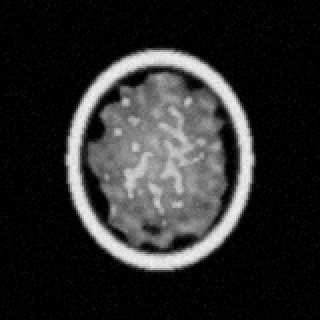
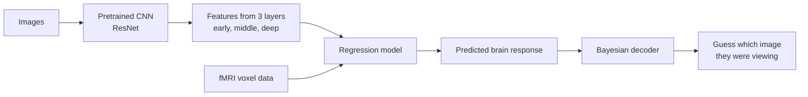

# Mind vs. Machine: fMRI Decoding with CNNs and Bayesian Inference
 
<p align="center">
  
</p>
Do artificial and biological vision systems process images in similar ways?
 
The human visual system processes what we see in a hierarchy: early regions respond to edges and colors, while later regions respond to whole objects and scenes. CNNs were inspired by this design and learn a similar layered sequence. Drawing on Claude Shannon's information theory, many researchers argue this is no coincidence: any system that efficiently encodes natural images may converge on a similar solution.
 
This project puts that idea to the test. Using fMRI scans from people viewing ~5,000 natural images (BOLD5000), we build **encoding models** that predict voxel-level brain activity from CNN features, then flip them into a **Bayesian decoder** that identifies which image a person was viewing from their brain activity alone.
 
---
 
## Research Questions
 
| # | Question | Approach |
|---|----------|----------|
| **RQ1** | Do early, middle, and deep CNN layers strictly correspond to early, middle, and late visual processing regions in the human brain? | Compare encoding accuracy of each CNN layer across each visual region of interest or ROI |
| **RQ2** | How much does adding an image prior help the Bayesian model pick the right image, compared to relying only on the predicted brain response? | Compare identification accuracy of likelihood-only vs. full posterior (likelihood × prior) decoding |
| **RQ3** | Which copula family best captures the non-linear dependency structure and tail behavior between CNN feature representations and fMRI voxel activations? | Fit copulas to feature–voxel pairs and compare by AIC and tail dependence |
 
---
 
## Pipeline Overview
 

 
**Step 1: Get CNN features.** We run each image through a pretrained ResNet-50 and extract features from three layers (early, middle, and deep). Each layer slides small learned filters, called kernels, across the image to produce feature maps. Early kernels detect edges and colors, while deeper ones combine these to detect textures, object parts, and whole objects. We average each layer's feature maps across space to get one feature vector per image.
 
<p align="center">
  
</p>

**Step 2: Predict brain activity.** A regression model learns how the CNN features relate to fMRI voxel activity in each brain region. We check how well it predicts brain responses for images it hasn't seen before.
 
**Step 3: Decode the image with Bayes.** Now we flip it. Given a brain scan, we score every candidate image by its likelihood (how well its predicted brain response matches the real scan) and its prior (how likely that image was to begin with), then pick the image with the best combined score.
 
**Step 4: Compare layers to brain regions.** We check which CNN layer best predicts each brain region. If CNNs really mirror the brain, early layers should match early regions and deep layers should match later regions. The figure shows the brain from two angles because some regions sit on the outside of the brain and others on the inside. The **lateral** view is the outer surface seen from the side, and the **medial** view is the inner surface you'd see if you split the brain down the middle. LOC and OPA appear mainly in the lateral view because they sit on the outer surface, while RSC and PPA appear in the medial view because they sit on the inner surface and underside. Early visual cortex shows up in both because it wraps around the back of the brain.
 
<p align="center">
  
</p>
**Step 5: Copulas.** Regression captures the average relationship between predicted and actual brain activity, but not whether that relationship changes at the extremes. Using unseen images, we pair each region's predicted response with its actual response and fit several copula families to these pairs. A Gaussian copula treats the relationship as symmetric, Clayton captures stronger agreement when both values are low, and Gumbel captures stronger agreement when both values are high. We pick the best-fitting family using AIC.
 
---
 
## Data
 
We use the **BOLD5000** dataset, where 4 participants viewed around 5,000 images (from SUN, COCO, and ImageNet) inside an fMRI scanner.
 
We focus on participant **CSI1** (15 sessions, 5,254 trials, 4,916 unique images) and use the Release 2.0 single-trial brain responses, estimated with GLMsingle, for five visual regions: early visual cortex (EVC), LOC, OPA, PPA, and RSC.
 
| Source | What's there |
|--------|--------------|
| [BOLD5000 website](https://bold5000-dataset.github.io/website/) | Overview, download links, and stimulus images |
| [Figshare (Release 2.0)](https://figshare.com/articles/dataset/BOLD5000_Release_2_0/14456124) | Updated, less noisy fMRI estimates (used in this project) |
| [Figshare (Release 1.0)](https://figshare.com/articles/BOLD5000/6459449) | Original release: ROI data, image labels, behavioral data |
| [OpenNeuro](https://openneuro.org/datasets/ds001499) | Raw fMRI data, event files (trial order), and ROI masks |
| [BOLD5000 paper](https://arxiv.org/abs/1809.01281) | Chang et al. (2019) |
 
### Getting the data
1. Download the stimulus images (`BOLD5000_Stimuli.zip`) from the [BOLD5000 download page](https://bold5000-dataset.github.io/website/download.html) and unzip them into `data/stimuli/`
2. Download `BOLD5000_GLMsingle_ROI_betas.zip` from Figshare Release 2.0 and unzip it into `data/fmri/roi_betas/`
3. Download CSI1's event files from OpenNeuro into `data/fmri/ds001499/`. These record which image was shown on each trial, in scan order:
```bash
aws s3 cp --no-sign-request s3://openneuro.org/ds001499/ data/fmri/ds001499 --recursive --exclude "*" --include "sub-CSI1/*events.tsv"
```
4. Build the trial table that maps each trial to its image (`src/build_trial_table_events.py`)
5. Build the brain response matrices (`src/build_y.py`). This combines hemispheres, z-scores each voxel within each session, and averages repeated images.
The data files are too big for GitHub, so they're not included in this repo.
 
---
 
## Repo Structure
 
```
mind-vs-machine-fmri-decoding/
├── assets/          # Images and diagrams used in this README
├── data/            # BOLD5000 images and fMRI data (not tracked)
├── notebooks/       # Analysis notebooks
├── src/             # Feature extraction, models, and decoding code
├── results/         # Plots and outputs
├── LICENSE
└── README.md
```
 
---
 
## Skills
Python, PyTorch, CNNs, regression, Bayesian inference, copulas, fMRI analysis, data visualization
 
## References
Chang, N., Pyles, J. A., Marcus, A., Gupta, A., Tarr, M. J., & Aminoff, E. M. (2019). BOLD5000, a public fMRI dataset while viewing 5000 visual images. *Scientific Data, 6*, 49.
 
Prince, J. S., Charest, I., Kurzawski, J. W., Pyles, J. A., Tarr, M. J., & Kay, K. N. (2022). Improving the accuracy of single-trial fMRI response estimates using GLMsingle. *eLife, 11*, e77599.
