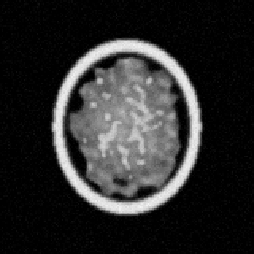
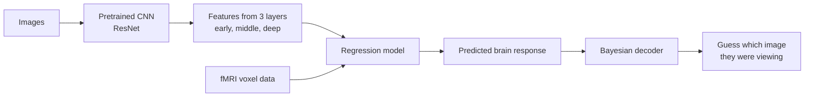

# Mind vs. Machine: fMRI Decoding with CNNs and Bayesian Inference
 
<p align="center">
  
</p>
Do artificial and biological vision systems process images in similar ways?
 
The human visual system processes what we see in a hierarchy: early regions respond to edges and colors, while later regions respond to whole objects and scenes. Convolutional neural networks (CNNs) were inspired by this design and learn a similar layered sequence. Drawing on Claude Shannon's information theory, many researchers argue this is no coincidence. Any system that efficiently encodes natural images may converge on a similar solution.
 
This project puts that idea to the test. Using fMRI scans from people viewing ~5,000 natural images (BOLD5000), we build **encoding models** that predict voxel-level brain activity from CNN features, then flip them into a **Bayesian decoder** that identifies which image a person was viewing from their brain activity alone.
 
---
 
## Research Questions
 
| # | Question | Approach |
|---|----------|----------|
| **RQ1** | Do early, middle, and deep CNN layers strictly correspond to early, middle, and late visual processing regions in the human brain? | Compare encoding accuracy of each CNN layer across each visual region of interest or ROI |
| **RQ2** | How much does adding an image prior help the Bayesian model pick the right image, compared to relying only on the predicted brain response? | Compare identification accuracy of likelihood-only vs. full posterior (likelihood × prior) decoding |
| **RQ3** | Which copula family best captures the non-linear dependency structure and tail behavior between CNN feature representations and fMRI voxel activations? | Fit copulas to feature–voxel pairs and compare by AIC/BIC and tail dependence |
 
---
 
## Pipeline Overview
 

 
**Step 1: Get CNN features.** We run each image through a pretrained ResNet-50 and save features from three layers: early, middle, and deep.
 
<p align="center">
  
</p>
**Step 2: Predict brain activity.** A regression model learns how the CNN features relate to fMRI voxel activity in each brain region. We check how well it predicts brain responses for images it hasn't seen before.
 
**Step 3: Decode the image with Bayes.** Now we flip it. Given a brain scan, we score every candidate image by its likelihood (how well its predicted brain response matches the real scan) and its prior (how likely that image was to begin with), then pick the image with the best combined score.
 
**Step 4: Compare layers to brain regions.** We check which CNN layer best predicts each brain region. If CNNs really mirror the brain, early layers should match early regions and deep layers should match later regions:
 
<p align="center">
  
</p>
**Step 5: Copulas.** Regression assumes the relationship between features and brain activity is linear, but that might not be true. Copulas let us look at the shape of the relationship, especially at the extremes. A Gaussian copula treats the relationship as symmetric, Clayton focuses on cases where both values are low, and Gumbel focuses on cases where both values are high.
 
---
 
## Data
 
We use the **BOLD5000** dataset, where 4 participants viewed around 5,000 images (from SUN, COCO, and ImageNet) inside an fMRI scanner.
 
| Source | What's there |
|--------|--------------|
| [BOLD5000 website](https://bold5000-dataset.github.io/website/) | Overview and download links |
| [Figshare (Release 1.0)](https://figshare.com/articles/BOLD5000/6459449) | ROI voxel data, images, labels |
| [Figshare (Release 2.0)](https://doi.org/10.1184/R1/c.5325683) | Updated, less noisy fMRI estimates |
| [OpenNeuro](https://openneuro.org/datasets/ds001499) | Raw fMRI data and ROI masks |
| [BOLD5000 paper](https://arxiv.org/abs/1809.01281) | Chang et al. (2019) |
 
### Getting the data
1. Download the stimulus images from the BOLD5000 website and put them in `data/stimuli/`
2. Download the ROI voxel data (`.mat` files, one set per subject) from Figshare Release 1.0 and put them in `data/fmri/`
3. Match each image to its fMRI voxel responses using the image name lists. If an image was shown more than once, average the responses.
The data files are too big for GitHub, so they're not included in this repo.
 
---
 
## Repo Structure
 
```
mind-vs-machine-fmri-decoding/
├── data/            # BOLD5000 images and fMRI data (not tracked)
├── figures/         # Diagrams used in this README
├── notebooks/       # Analysis notebooks
├── src/             # Feature extraction, models, and decoding code
├── results/         # Plots and outputs
├── brain_scan.gif
└── README.md
```
 
---
 
## Skills
Python, PyTorch, CNNs, regression, Bayesian inference, copulas, fMRI analysis, data visualization
 
## Reference
Chang, N., Pyles, J. A., Marcus, A., Gupta, A., Tarr, M. J., & Aminoff, E. M. (2019). BOLD5000, a public fMRI dataset while viewing 5000 visual images. *Scientific Data, 6*, 49.
 
